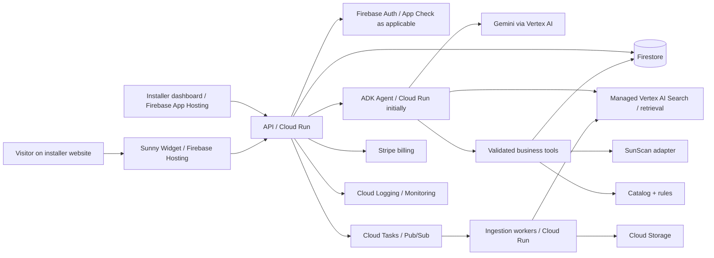

# Sunny.ai — Executable Engineering Plan

**Status:** Planning baseline, not an assertion that anything has been implemented  
**Version:** 1.0 | **Date:** 10 October 2026  
**Audience:** Autonomous coding agents and engineers with access to the Sunny.ai workspace, mascot assets, architecture blueprint and SunScan repository.

> **Agent operating contract:** This is a build plan, not a request to produce another plan. First inspect the actual repositories and assets, record discrepancies, and then execute phases in order. Implement, test, commit and document working increments. Never mark a feature complete on the strength of a mock-up. Do not invent SunScan APIs, Google product capabilities, pricing or credentials. Ask for approval only at genuine external/account/billing/destructive boundaries; otherwise make documented decisions and proceed.

## 1. Product outcome and non-negotiables

Sunny.ai is a multi-tenant, Google Cloud-first SaaS platform for solar installers. Each installer embeds a friendly, animated AI assistant on its website to answer grounded questions, collect structured qualification data, recommend compatible products/packages, integrate with SunScan property assessments and capture leads. The product includes a marketing website, customer onboarding, a management dashboard, a character customisation studio, a deployable widget, analytics, and optional voice, email and website guidance.

**The experience is the differentiator:** Sunny is a vivid Fanta-inspired orange sun with eight slightly rounded triangular rays, long black rounded-rectangle eyes with small upper-left highlights, a long black line smile and a restrained early-1930s rubber-hose cartoon influence. It is cheerful, confident, slightly cheeky and expressive without being distracting or childish. Preserve the supplied reference artwork as canonical; do not recreate the design from prose when reference assets are available.

**Operational preference:** Pay more for managed Google services when they materially reduce implementation and operations burden. Automate infrastructure with IaC and deployment scripts. Do not require the owner to manually assemble cloud services. Genuine exceptions include billing, account authentication, OAuth approvals, DNS/domain ownership, payment provider onboarding and other explicit third-party consent.

**Product completeness:** The requested *final scope* includes the full animation library, playable games, voice/email and website guidance. However, build in independently shippable vertical slices with quality gates. “Finished” requires real integrations, security, tests, deployment and documented acceptance evidence, not just completed UI.

## 2. Source-of-truth hierarchy and discovery gate

1. **Actual code and schemas** in SunScan and any existing Sunny.ai repository determine what already exists and what can be integrated.
2. **Provided Sunny images/animation references** determine character proportions, eyes, smile, rays, line weight and animation language.
3. **Provided solar SaaS blueprint** determines intended capabilities and constraints; reconcile it with current product requirements, but do not claim it specifies unknown API contracts.
4. **This plan** specifies the desired architecture and execution order; verify managed service support against current official documentation before committing to implementation.
5. **Verified external APIs** determine actual supported Google/Stripe/telephony capabilities.

**Gate D0 — inspect before coding:** Inventory repositories, package manifests, current CI, test suites, environment examples, animation files and all permitted SunScan directories. Inspect SunScan's questionnaire, lead schema, address lookup, property model/3D rendering, solar estimates, auth and APIs. Record findings in `docs/discovery.md` and a requirements traceability table (`requirement | source | implementation | test | status`). If a source is absent, mark **UNVERIFIED**, implement a typed adapter/mock only for development and block *production integration acceptance* until real credentials/contracts are available. Do not modify SunScan without permission.

**Deliverables:** `docs/discovery.md`, `docs/requirements-matrix.md`, `docs/architecture/adr-001-platform.md`, `docs/integration/sunscan-contract.md`, `docs/design/character-reference.md`.

## 3. Target architecture and explicit decisions

### 3.1 Architecture overview



**Default implementation decisions:**

| Concern | Preferred implementation | Why / qualification |
|---|---|---|
| Marketing site + dashboard | Next.js / TypeScript on Firebase App Hosting | Managed deploys; separate apps if release/security isolation warrants |
| Embeddable widget | TypeScript, isolated Shadow DOM or iframe; Firebase Hosting | Small framework-agnostic script; use iframe for stronger isolation if cross-site integration allows |
| APIs and business logic | Cloud Run, TypeScript by default | Shared types and minimal operational overhead; Python worker only if justified |
| AI | Gemini through Vertex AI, Google ADK | Keep model ID/configuration swappable; evaluate managed Agent Engine after functional Cloud Run orchestration |
| Operational DB | Firestore | Simple managed persistence; model query patterns before schema design |
| Identity | Firebase Authentication | Tenant membership/roles enforced on server, not solely by client claims |
| Documents/assets | Cloud Storage | Private buckets, signed access as appropriate |
| Search/RAG | Managed Vertex AI Search/Gemini Enterprise retrieval **subject to verification** | Confirm multi-tenant isolation, external Google Drive OAuth, indexing and region; fallback is a small Cloud Run connector with Google-managed indexing |
| Async work | Cloud Tasks, Pub/Sub, Cloud Scheduler | Retries, idempotency, sync |
| Security | IAM, Secret Manager, Model Armor where supported, Cloud Armor, application policies | Model Armor is not a replacement for auth/validation; check API path coverage |
| Observability | Cloud Logging, Monitoring, Trace, Error Reporting | Request correlation, costs, alerts |
| Analytics | Firestore operational counters; BigQuery for aggregates if needed | Never use synthetic production metrics |
| Payments | Stripe | External exception to Google-first requirement |
| Animation | Rive interactive rig + GSAP/Motion/SVG as needed | Google does not supply an equivalent web character animation runtime |
| Voice | Gemini Live API where supported | Telephone carrier connectivity requires external provider |
| Email | Gmail API for Workspace, Microsoft Graph only if needed | Human-reviewed drafts first |

**Architecture decision checkpoints:** Verify Firebase App Hosting support for selected Next.js version; managed retrieval licensing/pricing/tenant isolation; Gemini/Live/Model Armor compatibility; Firebase App Check usefulness on embedded third-party domains; region and data residency; cross-origin cookie restrictions; iframe versus Shadow DOM; Stripe billing events. Record decisions as ADRs before integration work. Never silently assume a managed connector can index arbitrary customer Drive folders.

### 3.2 Repository layout

```text
sunny-ai/
  apps/marketing/                # public Next.js site
  apps/dashboard/                # authenticated Next.js tenant UI
  apps/api/                      # Cloud Run API + AI orchestration
  apps/widget-demo/              # external-host integration test fixture
  packages/widget/               # independently built embeddable script
  packages/character/            # rig, states, animation contracts
  packages/animation-engine/     # scheduler, props, reduced motion
  packages/ui/                   # shared tokens and components
  packages/contracts/            # schemas and generated client types
  packages/sunscan-adapter/      # verified contract, dev fake only
  packages/solar-rules/          # deterministic recommendation constraints
  infrastructure/terraform/     # dev/staging/prod
  scripts/                       # bootstrap, seed, smoke, rollback
  docs/                          # ADRs, runbooks, design, integration
  tests/e2e/ tests/security/ tests/visual/
```

Use a monorepo tool only if it helps. Choose one package manager and lockfile. Do not split into microservices without measured need.

## 4. Data contracts and tenancy

**Proposed Firestore logical entities:** `tenants`, `memberships`, `widgetConfigs`, `domains`, `conversations`, `messages`, `qualificationSessions`, `questionnaireVersions`, `leads`, `products`, `productVariants`, `packages`, `recommendations`, `knowledgeSources`, `ingestionJobs`, `integrationConnections`, `usageRecords`, `auditEvents`, `subscriptions`, `animationPreferences`.

- Every tenant-owned record has a server-validated `tenantId`; index by tenant and access pattern. Avoid unbounded message arrays in one document.
- Firebase Auth identifies the dashboard user. Server resolves memberships and roles (`owner`, `admin`, `sales`, `viewer`) on every privileged request. Visitor sessions use short-lived, scoped identifiers; a public widget ID is never an admin credential.
- Lead and qualification records have explicit consent provenance, source, timestamps, retention and deletion support.
- `product` schema: tenant, manufacturer, model, category, power/capacity, price/currency/status, compatibility attributes, warranty, source version, image/document references. Missing fields remain null, never inferred.
- Questionnaire is **versioned**, typed and conditional. SunScan's discovered schema is canonical for integration fields; provide a mapping document rather than hardcoding imagined questions.
- Recommendation output includes selected catalogue IDs, constraints checked, evidence/source references, estimated versus verified values and reasons for exclusions.
- Audit events record privileged changes and tool actions without unnecessarily copying sensitive user content.
- Store secrets in Secret Manager; store only references and connection metadata in Firestore.

**Required API contract groups** (OpenAPI/JSON Schema/Zod or equivalent, with generated client types):

```text
POST /v1/widget/session
POST /v1/chat/stream
GET  /v1/widget/config/:publicId
POST /v1/qualification/answer
POST /v1/leads
GET  /v1/catalog/products
POST /v1/recommendations
POST /v1/sunscan/assessments
GET  /v1/sunscan/assessments/:id
GET  /v1/dashboard/metrics
POST /v1/knowledge/sources
GET  /v1/knowledge/jobs/:id
POST /v1/integrations/google-drive/connect
POST /v1/billing/webhook
```

These are **target Sunny APIs**, not assertions about SunScan or Google APIs. Specify auth, validation, idempotency, errors and rate limits for each. Streaming transport must be verified for the chosen hosting stack.

## 5. Character and design specification

### 5.1 Visual tokens

- Brand orange `#FF7900`; deeper orange `#FF6500`; soft orange `#FFB066`; pale orange `#FFF1E5`; warm white `#FFFCF8`; ink `#171717`; muted `#727272`.
- Aim for ~70% white/warm white, 20% orange family, 10% neutrals; not an orange wall.
- Friendly premium typography: evaluate Plus Jakarta Sans, DM Sans or Manrope; one primary family.
- Rounded cards, clear hierarchy, airy layouts, accessible contrast, soft shadows, pill controls, original wavy orange hills.
- Restrained vintage-cartoon influence: expressive timing and elastic rays, not distressed textures or a children’s game aesthetic.

### 5.2 Character rig

- Eight rounded triangular rays; body circle; black long rounded-rectangle eyes with upper-left small highlights; one long black curved smile; reference artwork determines exact proportions.
- Rig controls: eye aim/blink, brows, smile, body position/rotation, squash/stretch, independent ray transforms, ray-to-arm morph, hand gestures, attached props and theme colour.
- Implement a **single state machine** with `idle`, `listening`, `thinking`, `speaking`, `guiding`, `celebrating`, `confused`, `relaxing`, `playing`, `error`.
- Scheduler priorities: direct interaction > accessibility/error > chat/guidance > success > user-invoked games > idle. Each sequence has `id`, `priority`, `duration`, `canInterrupt`, `loop`, `assets`, `cleanup`, `reducedMotionFallback`.
- The AI emits structured *application events* (`message_started`, `tool_started`, `recommendation_ready`, `lead_saved`) and the UI maps events to approved animations. **Never execute arbitrary model-authored animation scripts.**
- Support Off/Minimal/Balanced/Playful intensity, pause, `prefers-reduced-motion`, tab visibility, low-power mode and responsive scale. Idle personality should be sparse.

### 5.3 Animation backlog and acceptance

| ID | Animation | Implementation / trigger | Acceptance |
|---|---|---|---|
| A01 | Idle, blink, eye tracking | Lightweight default | No intrusive looping; off-screen pause |
| A02 | Thinking/eureka | Rays spin, ray morphs to chin-stroking arm, another to bobbing question mark, eureka | Interruptible; all rays restore |
| A03 | Sunglasses | Arm pulls out shades | Props cleaned up |
| A04 | Deckchair sunbathe | Chair unfolds, shades, relax | Stops immediately on user interaction |
| A05 | Balloon | Balloon floats, gaze follows, optional tap/pop | Pointer/touch + reduced motion |
| A06 | Tic-tac-toe | Real 3×3 game against Sunny | Legal turns, win/draw/replay tests |
| A07 | Shuffle/run/dance | Separate short moves | No animation collisions |
| A08 | Space Invaders | Lazy-loaded arcade game | Real collision, score, restart |
| A09 | Ping pong | Paddle from ray, rally, optional user control | Working interaction |
| A10 | Arcade spin | Original fast roll/spin, not Sonic IP | Returns to exact default pose |
| A11 | Plant flower | Seed, shine, sprout, flower | Solar-theme showcase |
| A12 | Charge panel/phone | Panel unfolds, sunlight beam, battery fills | Tied to solar education context |
| A13 | Kickflip | Mini skateboard, flip, wobble | Props cleaned up |
| A14 | Barrel roll | 360° rotation | Motion-safe fallback |
| A15 | Melting ice cream | Pulls ice cream, accidentally melts, embarrassed smile | Signature comedic sequence |
| A16 | Rubik's cube | Turns faces, solves | Coherent sequence |
| A17 | Impossible cube | Turns, confused, shrugs | Clearly playful, not false solver |
| A18 | Seasonal themes | Spring/summer/autumn/winter and opt-in cultural themes | Tenant controls; no inferred religion |

**Five flagship sequences first:** idle, thinking/eureka, sunglasses, charging a panel, fizzy bubble-to-chat opening. Perfect those before expanding to A05–A18. Character animation test harness must allow deterministic replay, state inspection and screenshots.

## 6. User journeys and UX surfaces

### 6.1 Marketing website

Pages/sections: home, product, meet Sunny, how it works, integrations, pricing, resources, privacy/terms, sign-in and start. Hero headline **“Meet Sunny. Your brightest employee.”** Large living character emerges from orange bubble; eight rays settle; blink/smile/glance; rolling layered orange hills transition into next section. Use original bubbly motifs, **not Fanta trademarks, bottle shapes or branded trade dress**. Real sandboxed demo tenant offers prompts about savings, batteries, package choice and character capabilities. Showcase actual widget and dashboard, not stock screenshots. Colour-switching demo (orange, purple, green, blue, custom) updates Sunny and widget in real time. Animation gallery is interactive but lazy-loaded. Accessible and mobile-first; SSR/SEO where relevant.

### 6.2 Widget

Install through an async public script, e.g. `<script src="https://<actual-host>/widget.js" data-widget-id="PUBLIC_ID" async></script>` (replace host at deploy). Launcher at configurable corner, safe areas and z-index. Click: Sunny reacts → small fizzy bubbles rise → bubble expands into panel → Sunny settles into header → greeting appears, approximately 400–650 ms on capable devices. Reduced motion opens immediately. Panel: company identity, chat history, suggestions, text composer, product cards, qualification prompts, voice if enabled, handoff, privacy, close/minimise. Persist session per approved retention policy. Keep host page working if Sunny fails. Isolate CSS/JS via iframe or Shadow DOM; test WordPress, React, Next.js and plain HTML. Never read host credentials/cookies.

### 6.3 Tenant onboarding

Signup → organisation → authorised domain → connect website/Drive → upload catalogue → review SunScan questionnaire mapping → customise Sunny → preview → install script → send test message → go live. Persist wizard state and show precise connection/import status. No customer needs a Google Cloud account; they connect sources through the SaaS dashboard.

### 6.4 Dashboard

Overview (real conversations, qualified leads, engagement, source health, usage), conversations inbox, lead details/assignment, knowledge sources/sync jobs, catalogue/products/packages, SunScan assessments, Sunny Studio (left settings, centre animated preview, right live widget), integrations, team/roles, billing, analytics. Distinguish connected, disconnected, pending and failed states. Analytics must be based on events, with clear denominators and date ranges.

## 7. AI, RAG, qualification and recommendation behaviour

### 7.1 AI orchestration

Build a headless agent callable from chat, voice and email adapters. Start with ADK on Cloud Run for predictable deployment; assess Agent Engine only if its managed runtime supports the needed tools, isolation, latency, costs and operations. Gemini Flash-class default, configurable escalation to a stronger Gemini model for difficult tasks. Streaming when supported. Structured tool invocation and server validation. The model never has direct Firestore admin access.

**Approved tools:** `retrieve_knowledge`, `get_questionnaire`, `save_answer`, `search_catalogue`, `validate_compatibility`, `recommend_packages`, `calculate_approved_estimate`, `start_sunscan_assessment`, `get_sunscan_result`, `create_lead`, `request_callback`, `handoff_to_human`, `suggest_page_action`.

### 7.2 RAG ingestion

Per-tenant website sources, Google Drive/Docs, PDFs, structured catalogue, warranty/finance/service area documents. Confirm whether managed Vertex AI Search supports external per-customer OAuth, folder scoping, incremental changes, document deletion and strict tenant ACLs. If not, implement a Cloud Run Google Drive connector (OAuth, changes/watch renewal, retries, permission reconciliation) feeding an appropriately isolated Google-managed index. Preserve headings, tables, part numbers, warranty, prices, source URLs and versions. Use Document AI only when needed. Treat retrieved text as untrusted; cite sources in the assistant response when appropriate. Missing evidence → transparent uncertainty and human handoff. Never fabricate rates, subsidies, guarantees or stock.

### 7.3 Qualification

Load the **actual SunScan questionnaire** if found. Build versioned field definitions, conditional logic, validation, optional/skippable steps, corrections, resume and consent. Conversational collection should extract multiple supplied answers without asking twice; deterministic validators accept/reject fields. A user can view and correct the collected details before lead submission.

### 7.4 Catalogue and recommendations

Installer uploads CSV/structured records and associated documents. Validate duplicates, units, model identifiers, currency, compatibility, warranty and provenance. Recommendations filter through deterministic compatibility and budget rules; the LLM explains the ranked eligible packages. Support follow-ups such as “cheaper”, “add a battery”, “three options”, “EV-ready”, and “under £8,000”, preserving prior constraints. Clearly label verified price vs indicative estimate, and assumptions vs survey-confirmed data. Product cards include source/model, specs, reasons, limitations, next step. Never present unverified solar yields or structural suitability as fact.

### 7.5 SunScan integration

Adapter contract must be derived from source code. Desired flow: validated address → SunScan assessment creation/status → actual 3D/property result → interpretation of available outputs → eligible catalogue packages → lead handoff. Use Cloud Tasks for long-running assessment and polling where required. Store assessment IDs/status/versions in Firestore. Embed 3D model only if the real renderer/API allows it. **Production acceptance blocked until verified integration tests pass.**

## 8. Premium capabilities

**Website guidance:** Implement an opt-in host SDK with an allowlist of named targets/actions (`highlight`, `scroll`, `navigate`, `focus`, `open_panel`). Sunny ray morphs to point at approved elements. No arbitrary model-generated JavaScript, unrestricted selectors, credential access or silent form submissions. Require explicit confirmation for consequential actions; visible stop control. Evaluate Google's computer-use capabilities only for supported, separately authorised workflows, never assume unrestricted browser control is safe in arbitrary embedded sites.

**Voice:** Gemini Live API where supported; permission-gated microphone, streaming speech/transcript, interrupt/mute/stop, accessible captions, Sunny listening/speaking reactions. For telephone calls use an external telephony provider and explicit recording disclosures. Shared business tools and tenant policies apply.

**Email:** Gmail API for Workspace; scoped OAuth; human-reviewed drafts by default; no automatic sending unless tenant explicitly enables and policy permits. Incoming email is untrusted and must not override system instructions. Microsoft 365 support requires Microsoft Graph as a justified exception.

**Games and seasonal cosmetics:** Optional/lazy-loaded and tenant-configurable. Never distract from active conversation or qualification.

## 9. Security, privacy, resilience and cost controls

**Threat model:** cross-tenant reads, prompt injection through crawled/Drive documents, malicious widget-origin traffic, forged webhooks, overbroad OAuth, unauthorised website actions, runaway Gemini usage, PII leakage, ingestion of unrelated private documents, replayed lead submissions, XSS/CSS injection, model/tool hallucination.

Controls:
- Enforce server-side tenant membership and per-tool authorisation; test cross-tenant denial systematically.
- Firebase Auth for dashboard; signed short-lived visitor sessions, origin/domain policy, abuse/rate limits. App Check only where compatible with third-party embedding; never treat it as sole defence.
- IAM least privilege, managed identities, Secret Manager, encrypted transit/storage, restricted storage access.
- Model Armor on **supported** AI paths, plus deterministic tool allowlists, schema validation, output checks, prompt-injection resilience and sensitive-data controls.
- Stripe webhook signature verification and idempotent event processing.
- Explicit retention, export/deletion, consent, UK GDPR considerations and privacy notices; avoid sending PII into analytics.
- Cloud Tasks retries with idempotency keys and dead-letter/error handling; ingestion reconciliation; graceful fallback on Gemini/search outages.
- Per-tenant daily/monthly request and token quotas; global safety ceilings; billing budgets and alerts (**alerts are not hard spending caps**); dashboards for model/search/ingestion spend.
- Separate dev/staging/prod resources; backups, restore test, runbooks, rollback and operational alerts.

## 10. Build phases: dependencies, deliverables, gates

**Rule:** Each phase produces working code, tests, docs and a commit. Do not proceed past a gate without recording evidence. Independent work may continue while external approval is pending.

| Phase | Prerequisites | Implement | Exit gate / evidence |
|---|---|---|---|
| P0 Discovery | Workspace access | Audit SunScan/assets/blueprint, service capability verification, ADRs, backlog | Source-of-truth map; no invented integration contracts |
| P1 Foundations | Google project/billing access | Monorepo, lint/types/tests, Terraform, Firebase, Cloud Run, Firestore, Secret Manager, CI/CD, health checks | One-command reproducible staging deploy; smoke test |
| P2 Design + character | Reference images | Tokens, rig, eye/smile/rays, state machine, flagship sequences, animation lab | Approved reference comparison; deterministic animation tests |
| P3 Marketing | P2 | Complete responsive site, hero, hills, interactive demo, showcase, pricing shell | Visual regression, Lighthouse/accessibility baseline, working demo |
| P4 Widget | P1–P2 | Async embed, isolated launcher/panel, bubble transition, streaming shell, theming, session | Plain HTML + React + Next.js fixtures pass |
| P5 AI core | P1/P4 | Gemini/ADK, tools, typed contracts, Firestore conversations, quotas, guardrails | Real multi-turn chat, streaming, failure handling, tenant isolation tests |
| P6 Knowledge | P5 | Source onboarding, Google retrieval, Drive/web ingestion, sync, source citations | Tenant A cannot retrieve B; update/delete reflected; ingestion tests |
| P7 Qualification | P0/P5 | Versioned SunScan-derived questionnaire, extraction, validation, lead capture | E2E qualification + correction + consent + lead persists |
| P8 Catalogue/recommend | P6/P7 | Upload, validation, deterministic compatibility, package cards, iterative refinement | Golden scenario tests; no fabricated product details |
| P9 SunScan | Verified actual API | Adapter, address/assessment/status/results, model link, lead flow | Real integration tests; if blocked, explicitly mark blocked |
| P10 Dashboard + onboarding | P1–P9 | All admin surfaces, Sunny Studio, source status, analytics, roles | New tenant can onboard and run live widget independently |
| P11 Full animation library | P2/P4 | A05–A18, games, seasonal cosmetics, lazy loading | Animation catalogue and playable tests pass |
| P12 Add-ons | P5/P10 | Voice, Gmail drafts, guidance SDK, entitlements | Real supported provider test per add-on; unsupported remains gated |
| P13 Billing/ops | P10 | Stripe checkout/portal/webhooks, plans, quotas, admin ops, backups, runbooks | Subscription lifecycle test, quota enforcement, restore drill |
| P14 Hardening/release | All | Security review, performance/load, accessibility, browser/mobile, monitoring, production deploy | Release checklist signed off with evidence and remaining limits |

**Milestone slices:**
- **M1 — Character delight:** Landing hero + rig + flagship animations + interactive showcase.
- **M2 — Real assistant:** External embed + real Gemini chat + tenant-safe conversation storage.
- **M3 — Solar sales:** Tenant knowledge + questionnaire + catalogue recommendations + leads.
- **M4 — Installer product:** Dashboard, self-service onboarding, billing, SunScan integration.
- **M5 — Complete Sunny:** Remaining animations, games, voice, email, guidance, production hardening.

## 11. Acceptance scenarios (must be automated where feasible)

1. **Fresh tenant:** Owner signs up, creates tenant, authorises domain, customises Sunny, connects a supported source, uploads catalogue, publishes widget; a visitor can chat without any Google Cloud setup.
2. **External embed:** Script on an unrelated plain HTML site loads asynchronously; launcher and panel open, host CSS unchanged, mobile safe area respected, host site still works if Sunny API fails.
3. **AI grounding:** Visitor asks for an unsupported warranty or incentive. Sunny does not invent an answer; it gives appropriate uncertainty and a follow-up option.
4. **Isolation:** Tenant A user/widget cannot read tenant B knowledge, leads, catalogue or analytics even by changing IDs and prompt-injecting content.
5. **Qualification:** Visitor answers several questions in one turn, edits a previous answer, consents to contact, submits once; lead appears correctly in dashboard.
6. **Recommendations:** Installer catalogue has incompatible battery/inverter combinations; Sunny excludes invalid combinations and explains constraints; budget refinement retains requirements.
7. **SunScan:** Given verified integration and valid address, assessment status and real result are shown; unavailable results are reported rather than invented.
8. **Animations:** Interrupt thinking, deckchair and ice cream sequences with user input; no lingering arm/prop or corrupted rays; reduced motion works.
9. **Games:** Tic-tac-toe has correct rules; Space Invaders has real scoring/collision; games are optional and lazy-loaded.
10. **Website guidance:** Model can only invoke approved host actions; unapproved element/submit is rejected; user can stop.
11. **Voice/email:** Correct consent/permissions; Gmail creates a reviewable draft, not an unsolicited send; voice can be interrupted.
12. **Billing:** Stripe test checkout/webhook changes entitlements exactly once; cancellation and failed payment behaviour are defined and tested.
13. **Resilience:** Gemini timeout, Drive revoked token, retrieval outage and Cloud Tasks retry produce safe UI and observable logs.
14. **Accessibility:** Keyboard-only chat and games where applicable; focus order, contrast, live region and reduced-motion checks pass.

## 12. Quality budgets and measurement

Set baseline and enforce measurable budgets rather than promising untested numbers. Targets to validate: character motion ~60 FPS on capable devices; widget launcher script small and async; heavy games and animation assets lazy-loaded; marketing Core Web Vitals in good range; chat first feedback immediate; animation opening ~400–650 ms unless reduced motion; zero severe accessibility violations; zero high/critical security findings; reliable rollback and health checks. Establish specific bundle/latency/error-rate thresholds after first measured staging build. Record p50/p95 latency and costs by tenant and model.

**Required automated checks:** formatting/lint, typecheck, unit, contract, integration, E2E Playwright, visual snapshots, axe accessibility, dependency/security scanning, Terraform validation, smoke test. Use test fixtures and seeded demo tenant; clearly separate them from production.

## 13. Infrastructure automation and runbooks

Provide `scripts/bootstrap-google-cloud.sh` or cross-platform equivalent and `README_DEPLOY.md` that:

1. Check `gcloud`, Terraform, Node/toolchain and credentials.
2. Confirm project, billing, environment and region **before** provisioning paid resources.
3. Enable required APIs and create least-privilege service identities.
4. Apply Terraform to provision Cloud Run, Firestore, Storage, queues, secrets references, hosting, logging/monitoring and supported AI resources.
5. Request unavoidable secrets/authorisations securely (never echo/store plaintext in repo).
6. Run migrations/index provisioning, builds, tests, deploys and health checks.
7. Print actual URLs, widget script URL, admin login route, test instructions, costs/alerts and unresolved external steps.

Also provide `scripts/deploy-staging`, `scripts/deploy-production`, `scripts/smoke-test`, `scripts/rollback`, `scripts/seed-demo`, `scripts/verify-isolation`, and backup/restore instructions. Scripts must be idempotent and fail clearly. Never perform destructive production changes without explicit approval.

## 14. Delivery management and agent continuation protocol

Maintain `docs/STATUS.md` after every substantial work session with:

```markdown
## Current phase
## Completed (with commit IDs and test evidence)
## In progress
## Blockers / owner actions
## Known risks
## Next three executable tasks
## Deployment URLs and environment status
```

Maintain `docs/DECISIONS.md` for meaningful design/architecture choices and `docs/RELEASE_CHECKLIST.md` for all acceptance gates. Prefer small, coherent commits. Run tests before claiming completion. Never hide missing credentials, unavailable Google connector features or mock-only implementations. If blocked on SunScan or OAuth, continue other phases and keep production acceptance marked blocked.

### Agent's first execution batch

**Do these actions immediately, in this order:**

1. Print a concise workspace inventory: current repo, nearby permitted SunScan folder, supplied PDF and mascot assets.
2. Inspect code and documents; create discovery and requirements matrix.
3. Verify current official Google Cloud documentation for the selected services, especially App Hosting, ADK/Agent Engine, managed RAG, Drive connectors, Model Armor, Live API and regions.
4. Write 3–5 ADRs covering hosting, agent runtime, retrieval isolation, widget isolation and Firestore data modelling.
5. Create monorepo skeleton, tooling, CI and Google IaC for a staging deployment.
6. Build the character rig and animation playground against the supplied reference image.
7. Build the first complete vertical slice: a hosted page containing Sunny → animated widget open → real Gemini response → persisted conversation.
8. Report actual test output, deployed URL if available, blockers and next tasks in `docs/STATUS.md`.

**Do not spend the first implementation session writing another enormous proposal. Start producing runnable code after the discovery gate.**

## 15. Explicit exclusions, uncertainties and owner approvals

- **Not assumed:** SunScan questionnaire/API/model data; Google Drive connector's external multi-tenant folder support; managed Agent Engine fit; full Model Armor coverage; a Google-only public phone network; automatic OAuth verification; guaranteed cloud costs.
- **External exceptions:** Rive/GSAP/Motion for animations, Stripe for SaaS payments, telephony carrier if phone calling is offered, Microsoft Graph for Microsoft customers, DNS registrar as required.
- **Owner approvals:** Billing and cloud project selection, OAuth consent and verification, DNS/domain ownership, production spending ceilings, third-party connections, destructive operations, production launch.
- **Commercial decisions to expose as configuration:** Subscription prices, plan limits, trial length, retention period, available countries, handoff contacts, model routing, animation defaults.
- **Legal/product boundaries:** No unverified savings, subsidies, finance or engineering guarantees; clearly identify indicative estimates and require installer confirmation where appropriate.

## 16. Final release definition

Sunny.ai is **done** only when a new solar installer can sign up, connect authorised knowledge, upload its own products, configure and embed Sunny, have real tenant-isolated Gemini conversations, qualify visitors, receive validated recommendations and leads, manage them in a working dashboard, pay for an appropriate plan, and rely on monitored managed Google infrastructure. The full final scope also requires all listed animations/games, verified SunScan integration, and supported voice/email/guidance add-ons, each with real provider tests. Where an external dependency is unavailable, do not call the product fully complete; document the exact blocker.

**North star:** Visitors should think *“I want Sunny on my website.”* Installers should then discover that the charm is backed by a reliable, secure, functional sales product. The owner should not have to become a Google Cloud infrastructure engineer to run it.
